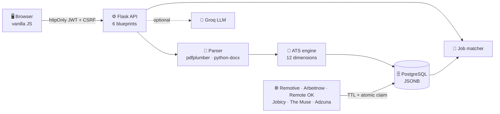
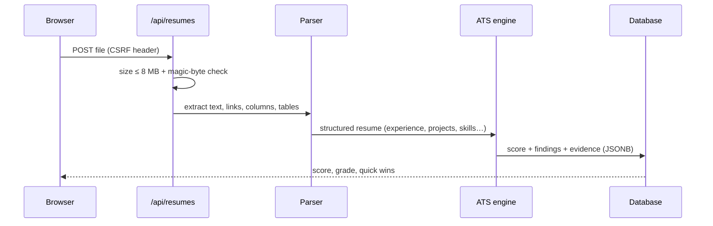
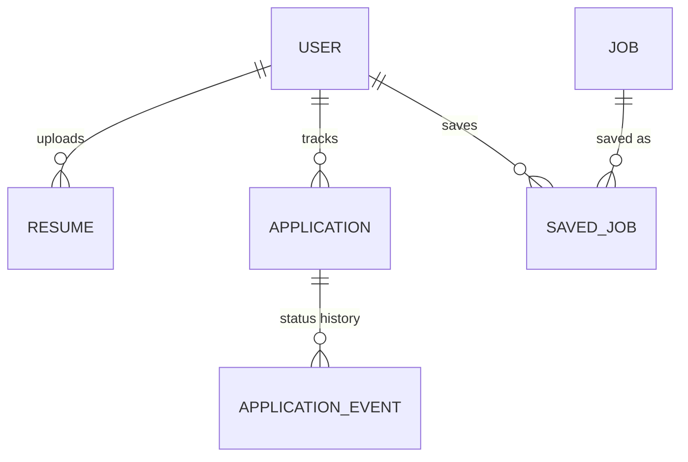
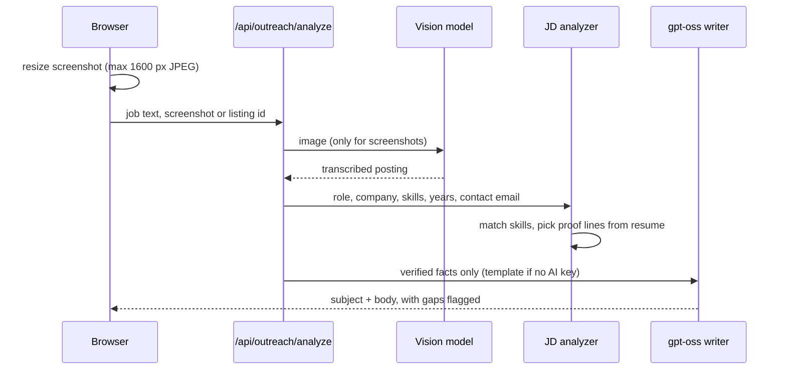

<div align="center">

# Resume Copilot

### Know exactly why your resume scores what it scores, then land the job.

A career platform with a **transparent, deterministic 100-point ATS engine**, live job matching, an application tracker and optional AI coaching.

[](https://resume-copilot-64eq.onrender.com/)
&nbsp;


**[ Try it live NOW](https://resume-copilot-64eq.onrender.com/)** · [Features](#-features) · [How scoring works](#-how-the-ats-score-works) · [Architecture](#-architecture) · [API](#-api-reference) · [Run locally](#-run-locally) · [Why it's different](#-why-its-different) · [Use case](#-real-use-case) · [Performance](#-performance)

<br>


</div>

> ⏳ The free Render instance sleeps when idle, so the first load can take ~30-50 s.

---

## 📊 At a glance

| | | | |
|:--:|:--:|:--:|:--:|
| **12** ATS dimensions | **3** career stages | **14** role profiles | **178** skills / 248 aliases |
| **38** endpoints | **6** job feeds | **34** tests | **8 MB** upload limit |
| **~100 ms** PDF extract + parse + score | **~11 ms** ranked job feed (450 cached jobs) | **8** data sources (6 job feeds + arXiv + OpenAlex) | **0** API keys needed for the core ATS engine |

---

## Features

<table>
<tr>
<td width="50%" valign="top">

### Explainable ATS score
Every point has evidence: what was found, what is missing, and the exact fix with its **point gain** ("+8.1 pts").
Hard caps: unreadable text → 35, no email → 60, no headings → 50.

</td>
<td width="50%" valign="top">

### JD matching
Paste a job description and get required vs preferred skills, labelled **in use / listed only / missing**.
`score = 0.7·skills + 0.2·keywords + 0.1·experience fit`

</td>
</tr>
<tr>
<td valign="top">

### Live opportunities
Jobs, internships and freelance gigs from free feeds, ranked by match to **your** resume.
`match = 0.55·skills + 0.25·role + 0.15·level + 0.05·recency`

</td>
<td valign="top">

### Application tracker
Kanban pipeline with status history: `saved → applied → OA → interview → offer / rejected`.

</td>
</tr>
<tr>
<td valign="top">

### Analytics dashboard
ATS trend, funnel, response rate, average days to first response, 12-week chart, 26-week activity heatmap, streak, market demand vs your skills, and a skill roadmap.

</td>
<td valign="top">

### AI coach (optional)
Recruiter-style review, JD tailoring, outreach messages (4 kinds) and interview feedback. **Works without an API key** using templates and STAR-based heuristics.

</td>
</tr>
<tr>
<td valign="top">

### Smart outreach from a job post or screenshot
Paste a job description, drop or **Ctrl+V a screenshot**, or pick a saved listing. The app extracts role, company, required skills, years asked and the recruiter's email, matches them to your resume, quotes your **best proof lines** (internships and metrics first) and writes a cold email, LinkedIn note, cover letter or referral in 3 tones. It **never claims a skill missing from your resume** and flags it as a gap instead.

</td>
<td valign="top">

### Never-blocking live feed
**Adzuna results are fetched first and shown immediately**; the other 5 feeds refresh in one background thread while the page updates itself (polling every 5 s with a "loading more" bar). Slow or failing providers can no longer freeze the dashboard or the opportunities page.

</td>
</tr>
</table>

<details>
<summary><b>🧪 More tools (click to expand)</b></summary>

- **Role-based skill gap:** core / important / nice-to-have skills per role, with a weeks-to-learn roadmap.
- **Interview practice:** question bank plus answer evaluation (STAR structure, metrics).
- **Outreach generator:** 4 message types, AI-written or template-based.
- **Explore:** deep links to job boards, pre-filled for your role.
- **Research feed:** latest papers from arXiv and OpenAlex for research-track roles.
- **Version history:** every upload is scored; the last 20 are kept so you can see your trend.
- **Download / re-score:** re-score any saved resume against a different target role.
- **Screenshot reading:** a vision model (Llama 4 Scout, with Maverick as fallback) transcribes a job screenshot, then `gpt-oss` writes the message, because `gpt-oss` is text-only. The image is resized to max 1600 px in the browser before upload.
- **Regenerate with edits:** correct the detected role or company and regenerate; the extracted text is reused, so a screenshot is not re-read.
- **Open in mail app:** when the posting contains a recruiter email, one click opens a pre-filled `mailto:` draft.
- **Deep links for platforms without a public API:** Internshala, Unstop, Devpost, Upwork, GSoC, Outreachy (opened as pre-filled searches, never scraped).

</details>

---

## 💡 Why it's different

| | What most resume tools do | What Resume Copilot does |
|---|---|---|
| **Explainability** | One opaque number | 12-part breakdown; each finding quotes the **original resume line**, the points at stake and a fix |
| **Fair to career stage** | Same rubric for everyone | Weights adapt: a fresher is judged on projects, internships, open source and certifications (14 + 14 + 4 + 4 pts); an experienced engineer on work history (30 pts) and impact (12 pts) |
| **Real impact metrics** | Counts any number as a "metric" | Years, phone numbers, CGPA and version numbers are ignored; only real outcomes count |
| **Keyword honesty** | Rewards keyword stuffing | Skill used inside a bullet = **1.0** credit, listed only = **0.6**; stuffed skill lists are flagged |
| **AI you can trust** | The LLM decides the score | Score is **deterministic and reproducible**; AI only adds review and rewrites, each checked against your resume text |
| **Honest outreach** | Generic templates | Quotes your real proof lines and **never claims a missing skill** |
| **AI optional** | Needs an API key | Full ATS analysis, JD match and template outreach work with **no key** |
| **Respects providers** | Scrapes job boards | Public APIs only, cached in PostgreSQL, rate-limited, attribution shown; no scraping |

---

## 🎯 Real use case

> Sample data from `tests/fixtures` (synthetic resumes, not real people).

**Aarav, a final-year B.Tech student, wants a backend internship at a fintech.**

1. He uploads his PDF. The engine detects **2 internships (6 months)**, **2 projects**, **3 certifications** (1 vendor-grade), a **strong open-source signal** (merged PRs) and a **Smart India Hackathon win**, and scores him **89/100 for Backend Developer** (86 for ML / AI Engineer, same resume, different role keywords).
2. A deliberately weak sample (objective statement, no experience, stuffed skills list, informal email) scores **35/100** with **22 findings** (1 critical, 13 warnings), each with a concrete fix.
3. He pastes a Razorpay "Backend Engineer Intern" posting, or a **screenshot** of it. The app extracts the role, company, required skills, years asked and the recruiter's email.
4. It flags **Kubernetes as a gap** (not on his resume) and picks his strongest matching proof: *"Built 6 REST API endpoints in FastAPI serving 12,000 daily requests with p95 latency under 120 ms."*
5. It writes a cold email around that proof, without claiming Kubernetes, and one click opens it in his mail app.

| Sample resume | Target role | Stage detected | Score | Findings |
|---|---|:--:|:--:|:--:|
| Weak fresher | Software Engineer | Fresher | **35** | 22 (1 critical, 13 warnings) |
| Strong fresher | Backend Developer | Fresher | **89** | 16 (0 critical, 6 warnings) |
| Experienced (6 yrs) | Backend Developer | Experienced | **85** | 13 (0 critical, 2 warnings) |

---

## How the ATS score works

The score is a weighted sum of **12 dimensions**. Weights depend on your **career stage**, so a fresher is not judged like a 10-year engineer. Each stage sums to exactly 100 (asserted in tests).

| Dimension | 🎓 Fresher | 🌱 Early | 💼 Experienced |
|---|:--:|:--:|:--:|
| Experience & internships | 14 | 24 | 30 |
| Role keyword match (skills) | 16 | 16 | 16 |
| Projects | 14 | 8 | 4 |
| Measurable impact | 8 | 10 | 12 |
| ATS readability (parse) | 10 | 10 | 10 |
| Structure & dates | 8 | 8 | 8 |
| Bullet writing | 8 | 8 | 8 |
| Contact & links | 6 | 6 | 6 |
| Education | 6 | 4 | 2 |
| Certifications | 4 | 3 | 2 |
| Open source | 4 | 2 | 1 |
| Achievements | 2 | 1 | 1 |
| **Total** | **100** | **100** | **100** |

<details>
<summary><b>🔬 What counts as a "real metric"?</b></summary>

9 regex patterns detect numbers that show impact: percentages, multipliers (`3x`), money (`Rs 40000`), counts (`12,000 daily requests`) and before/after values (`F1 0.71 → 0.84`).
They **ignore** years, phone numbers, CGPA and version numbers (`python 3.11`), so noise cannot game the score.

</details>

<details>
<summary><b>🛡️ How AI is kept honest</b></summary>

- The score is computed **only** by deterministic code; AI cannot change it.
- Bullet rewrites are **verified against your resume text**, so the model cannot invent facts.
- A prompt-injection guard is applied to uploaded text and job descriptions.
- Model fallback chain (default `openai/gpt-oss-120b` → `llama-3.3-70b-versatile` → `openai/gpt-oss-20b`) with retries.

</details>

<details>
<summary><b>🔎 What the parser detects (real findings)</b></summary>

- **Layout on real files:** multi-column PDFs, tables, text boxes, content hidden in headers/footers, scanned (image-only) PDFs, and whether LinkedIn/GitHub links are clickable.
- **Experience:** months worked (overlaps merged), employment gaps over 6 months, internship vs full-time vs freelance, reverse-chronological order.
- **Projects:** tech stack, link, detail lines and a measurable result for each.
- **Credentials:** certifications graded by issuer (vendor 1.0, platform 0.7, unknown 0.5), open source graded strong / mentioned / link only, and achievements (hackathons, coding ratings, ranks, scholarships, papers, leadership).
- **Writing:** action-verb starts, weak phrases ("responsible for", "worked on"), first-person pronouns, bullet length and repeated verbs.

</details>

---

## Architecture



<details>
<summary><b> Resume upload flow</b></summary>



</details>

<details>
<summary><b> Data model</b></summary>



7 tables (plus `source_sync` for feed status) · unique `lower(email)` index · unique `(source, external_id)` on jobs · JSONB for parsed resume, analysis and AI review.

</details>

<details>
<summary><b>✉️ Smart outreach flow</b></summary>



</details>

<details>
<summary><b>🧠 Design decisions worth noting</b></summary>

- **Non-blocking by design.** Pages never wait for upstream providers. Adzuna is queried first with a 7 s cap; the other feeds refresh in a single background thread guarded by a lock, and the UI polls until the data arrives.
- **Cheap ranking.** Job skills are extracted once at ingest and stored; ranking reuses them, so a request does no regex work. Only the columns needed for the list are loaded and the description is cut to a 400-character snippet in SQL.
- **Deterministic core, optional AI.** The LLM never changes the score. Resume, job text and screenshots are treated as untrusted data inside delimiters, and AI output is validated before it is shown.
- **Two model chains.** Text writing uses `openai/gpt-oss-120b` with fallbacks; screenshots use a separate vision chain, because `gpt-oss` is text-only. Both are configurable by environment variable.
- **Portable data layer.** PostgreSQL JSONB in production, SQLite for local development; the same test suite runs on both.
- **Late-DOM safety on the frontend.** Rendering helpers tolerate pages that changed while a request was in flight, and every API call has a timeout so no screen can stay on "loading" forever.

</details>

---

## 🌐 Job sources

| Source | Cache TTL |
|---|:--:|
| Arbeitnow | 4 h |
| Jobicy | 6 h |
| Remote OK | 6 h |
| Remotive | 8 h |
| The Muse | 8 h |
| Adzuna (needs key) | 30 min per query |
| arXiv, OpenAlex (research papers) | 1 h (in memory) |

Jobs are cached in the DB. A refresh slot is taken with an **atomic `UPDATE`**, so concurrent workers never double-fetch. One failing source never breaks the others, and jobs older than 45 days are pruned.

Remotive limits fetching and requires attribution, so its data is cached, refreshed at most every 8 h and credited in the UI. Platforms without a public API (Internshala, Unstop, Devpost, Upwork) are only **deep-linked**, never scraped. Always re-read each provider's terms before commercial use.

---

## ⚡ Performance

Measured locally: in-process, PostgreSQL 16, 450 cached listings, 15 runs each, network time excluded.

| Operation | Median | p95 |
|---|:--:|:--:|
| Extract + parse + score a PDF resume | ~100 ms | 159 ms |
| `GET /api/opportunities` (rank 300 candidates for your resume) | ~11 ms | 12 ms |
| `GET /api/opportunities?fast=1` (dashboard widget) | ~10 ms | 11 ms |
| `GET /api/analytics/overview` | ~9 ms | 18 ms |

---

## 🔐 Security

| Layer | What is done |
|---|---|
| Auth | Password hashing (werkzeug), JWT in **httpOnly** cookies, access 2 h / refresh 30 d |
| CSRF | Double-submit token required on every write (tested) |
| Uploads | PDF/DOCX/TXT only, **magic-byte** check, 8 MB cap |
| Isolation | Resumes are user-scoped; another user's resume returns 404 (tested) |
| Browser | CSP + security headers; dynamic HTML escaped on the frontend |
| Abuse | Per-route rate limits (Flask-Limiter) |
| Config | App refuses to start in production with a `SECRET_KEY` under 32 chars |
| Screenshots | PNG / JPG / WEBP only, **magic-byte** check, 3 MB cap, resized in the browser first |
| Rate limits (examples) | login 10/min, register 8/h, outreach 30/h, AI review 15/h |
| Untrusted text | Resume, job text and screenshots are passed to the LLM as delimited data, with injection guard; outputs are validated |
| Accounts | Password policy enforced server-side; account deletion removes all user data |

---

## API reference

<details>
<summary><b>All endpoints (click to expand)</b></summary>

| Area | Endpoints |
|---|---|
| **Auth** | `POST /api/auth/register` · `login` · `logout` · `refresh` · `change-password` · `GET /api/auth/me` · `PUT /api/profile` · `DELETE /api/auth/account` |
| **Resumes** | `POST /api/resumes` · `GET /api/resumes` · `GET /resumes/latest` · `GET/DELETE /resumes/<id>` · `GET /resumes/<id>/download` · `POST /resumes/<id>/rescore` · `ai-review` · `jd-match` · `tailor` |
| **Opportunities** | `GET /api/opportunities` · `GET /opportunities/<id>` · `POST/DELETE /opportunities/<id>/save` · `GET /api/saved` · `GET /api/sources/status` · `GET /api/explore` · `GET /api/research` · `GET /research/topics` |
| **Tracker** | `GET/POST /api/applications` · `PATCH/DELETE /applications/<id>` |
| **Analytics** | `GET /api/analytics/overview` · `GET /api/skill-gap` |
| **Tools** | `GET /api/meta` · `POST /api/outreach` · `POST /api/outreach/analyze` · `GET /api/interview/questions` · `POST /api/interview/evaluate` |
| **Ops** | `GET /healthz` |

**Extra notes**

- `GET /api/opportunities` query params: `kind` (job / internship / freelance), `q`, `location`, `remote=1`, `source`, `sort` (match / recent), `page`, `per_page`, `fast=1` (database only, used by the dashboard). The response includes `sync: "refreshing" | "fresh"` so the UI knows whether to keep polling.
- `POST /api/outreach/analyze` accepts `jd_text`, an `image` (multipart), or a `job_id`, plus `kind` (cold_email / linkedin_dm / cover_letter / referral), `tone` (concise / friendly / formal) and optional `role` / `company` overrides. It returns the detected job, resume fit, proof lines used, the message and notes about gaps.

</details>

---

## Testing

**34 tests** run in CI on **SQLite and PostgreSQL**, and the migration is checked too.

| Suite | Covers |
|---|---|
| `test_ats.py` | weights sum to 100, metric detection (ignores years/phones/CGPA), determinism, role sensitivity, JD match, stage detection |
| `test_extract.py` | PDF/DOCX/TXT parsing, links, layout checks |
| `test_api.py` | register/login/logout, cookie flags, CSRF, upload + magic bytes, user isolation, tracker, analytics, job dedupe, TTL claim, failure containment |
| `test_ai.py` | AI helpers and fallbacks with no API key |
| `test_outreach_and_speed.py` | JD analysis, resume-grounded messages that never claim missing skills, screenshot to email flow (vision then gpt-oss, mocked), image validation, AI failure fallback, non-blocking source refresh, Adzuna-first loading with caching, list speed with hundreds of jobs |

```bash
pip install -r requirements-dev.txt && pytest -q
```

---

## Project structure

```
app/
├── blueprints/     # route groups: auth, resumes, opportunities, applications, analytics, tools
├── services/       # ats.py · resume_parser.py · skills.py · matching.py · ai.py · analytics.py · jobtext.py
├── sources/        # job feed providers, registry (TTL + atomic claim), research, explore
├── static/js/      # frontend modules (dashboard, resume, tracker, tools…)
└── templates/
migrations/         # Alembic versioned schema, so `flask db upgrade` builds all tables anywhere
tests/              # pytest suite + fixtures/ (fresher, experienced, weak sample resumes)
.github/workflows/  # CI: pytest on SQLite + PostgreSQL, migration check
Dockerfile · docker-compose.yml · render.yaml · start.sh
```

---

## Run locally

```bash
git clone https://github.com/Krish033-source/Resume-Copilot && cd Resume-Copilot
python -m venv .venv && source .venv/bin/activate
pip install -r requirements.txt
cp .env.example .env          # set SECRET_KEY (32+ chars); GROQ_API_KEY is optional
flask db upgrade && flask run
```

**Docker:** `docker compose up`

<details>
<summary><b>⚙️ Environment variables</b></summary>

| Variable | Purpose | Default |
|---|---|---|
| `SECRET_KEY` | Flask/JWT secret (32+ chars in production) | required |
| `DATABASE_URL` | PostgreSQL URL | none |
| `GROQ_API_KEY` | Enables AI features | off |
| `GROQ_MODEL` | Primary model | `openai/gpt-oss-120b` |
| `ADZUNA_APP_ID` / `ADZUNA_APP_KEY` | Extra job source | off |
| `COOKIE_SECURE` | Secure cookies (set `0` for local http) | `1` |
| `AUTO_REFRESH_SOURCES` | Refresh job feeds in background | `1` |
| `RATELIMIT_STORAGE_URI` | Limiter backend (Redis for multi-worker) | `memory://` |
| `CORS_ORIGINS` | Allowed origins | empty |
| `GROQ_FALLBACK_MODELS` | Text models tried if the primary fails | `llama-3.3-70b-versatile,openai/gpt-oss-20b` |
| `GROQ_VISION_MODEL` | Vision model that reads job screenshots (`gpt-oss` is text-only) | `meta-llama/llama-4-scout-17b-16e-instruct` |
| `GROQ_VISION_FALLBACKS` | Vision models tried if the first fails | `meta-llama/llama-4-maverick-17b-128e-instruct` |
| `ADZUNA_COUNTRY` | Adzuna country code | `in` |
| `CONTACT_EMAIL` | Sent in the User-Agent and OpenAlex polite pool | empty |

</details>

---

## ⚠️ Limitations

- The ATS score is an **explainable heuristic**, not any employer's real ATS.
- The in-memory rate limiter needs a **single worker**; use Redis (`RATELIMIT_STORAGE_URI`) to scale out.
- `/api/opportunities` scores up to 300 cached jobs per request. Fine at this scale, but would need pre-computed scores beyond it.
- Scanned (image-only) PDFs are detected and flagged, but not OCR'd yet.
- Email verification and password reset are not implemented yet.
- The resume parser is heuristic and tuned for common English layouts; unusual templates may need manual review.
- Screenshot reading and the AI writer depend on Groq model availability; model names are configurable because they change often.
- Live job and paper APIs are covered by mocks and defensive parsing in tests; always check `/api/sources/status` after deploying.

## 🗺️ Roadmap

- [ ] Redis-backed rate limiting
- [ ] Pre-computed job match scores
- [ ] Test coverage report in CI
- [ ] Resume diff view between versions
- [ ] OCR fallback for scanned PDFs
- [ ] Email verification and password reset
- [ ] Browser end-to-end tests in CI
- [ ] Saved-search alerts for new matching listings

---

<div align="center">

Built by **[Krishna Lal](https://krbtech.xyz)** · [GitHub](https://github.com/Krish033-source)

⭐ Star the repo if it helped your resume.

</div>
