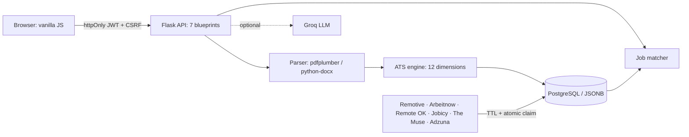

# Resume Copilot

**A career platform that scores your resume with a transparent, deterministic 100-point ATS engine, matches it to live jobs, and tracks every application.**


> Same resume → same score, every time. The LLM explains and rewrites; it **never** changes the score.

## At a glance

| | |
|---|---|
| ATS dimensions | **12**, weights sum to 100 (asserted in tests) |
| Career stages | **3** (fresher / early / experienced) with different weights |
| Role profiles | **14** (core / important / nice skills) |
| Skill taxonomy | **178** skills, **248** aliases, **15** categories |
| REST endpoints | **37** across 7 blueprints |
| Job feeds | **5** free + Adzuna, DB-cached with per-source TTL (4-8 h) |
| Tests | **34** (pytest) on SQLite + PostgreSQL in CI |
| Upload limit | 8 MB, PDF / DOCX / TXT, magic-byte checked |

## Features

- **Explainable ATS score:** every point comes with evidence (found / missing, with a fix). Caps for unreadable text, no email, no headings.
- **JD matching:** `0.7 skills + 0.2 keywords + 0.1 experience fit`; skills labelled *listed / in context / missing*.
- **Job match:** `0.55 skills + 0.25 role + 0.15 level + 0.05 recency`, best match first.
- **AI review (optional, Groq):** model fallback chain; rewrites are verified against your resume text; prompt-injection guard. Works without a key (template outreach, STAR-based interview feedback).
- **Tracker:** Kanban (saved → applied → OA → interview → offer / rejected) with status history.
- **Analytics:** ATS trend, funnel, response rate, avg days to response, 12-week chart, 26-week heatmap, streak, market demand, skill roadmap.

## Architecture



## ATS weights (by stage)

Weights live in `app/services/ats.py` (`WEIGHTS`); each stage sums to 100. A fresher is weighted on projects, skills and education; an experienced candidate on experience and impact.

## Engineering notes

- **Auth:** httpOnly cookies, CSRF double-submit, werkzeug hashing, case-insensitive unique email index, rate limits.
- **Security headers:** CSP + standard headers; frontend escapes all dynamic HTML.
- **Source refresh:** an atomic `UPDATE` claims the refresh slot, so concurrent workers never double-fetch; one failing source never breaks the rest.
- **Data:** Alembic migrations; JSONB on Postgres, JSON on SQLite; old jobs pruned after 45 days.
- **CI:** GitHub Actions runs pytest on SQLite and PostgreSQL and checks migrations.

## Project structure

```
app/
  blueprints/   # 7 route groups (auth, resumes, opportunities, applications, analytics, tools, common)
  services/     # ATS engine, resume parser, skills taxonomy, matching, AI, analytics
  sources/      # job feed providers + cached refresh logic
  static/ templates/   # frontend (vanilla JS)
migrations/     # Alembic: versioned DB schema history; `flask db upgrade` builds all 7 tables
tests/          # pytest suite: ATS scoring, resume extraction, API + auth, job sources, AI fallbacks
  fixtures/     # sample fresher / experienced / weak resumes used by the tests
```

- **`migrations/`**: every schema change is a versioned script, so any database (local, CI, production) is created identically with `flask db upgrade`.
- **`tests/`**: 34 tests cover scoring determinism, PDF/DOCX/TXT parsing, CSRF + cookie auth, per-user data isolation, job dedupe/TTL claim, and the no-API-key fallbacks.

## Run locally

```bash
git clone https://github.com/Krish033-source/resume-copilot && cd resume-copilot
python -m venv .venv && source .venv/bin/activate
pip install -r requirements.txt
cp .env.example .env        # set SECRET_KEY (32+ chars); GROQ_API_KEY is optional
flask db upgrade && flask run
```

Docker: `docker compose up`. Tests: `pip install -r requirements-dev.txt && pytest -q`.

## Limitations

- In-memory rate limiter: use 1 worker, or set `RATELIMIT_STORAGE_URI` to Redis.
- ATS is a heuristic, not any real employer's ATS.
- `/api/opportunities` scores up to 500 cached jobs per request in Python; fine at this scale, would need pre-computation beyond it.

## Roadmap

Redis rate limiting · pre-computed match scores · coverage report in CI.

---
Built by [Krishna Lal](https://krbtech.xyz)
