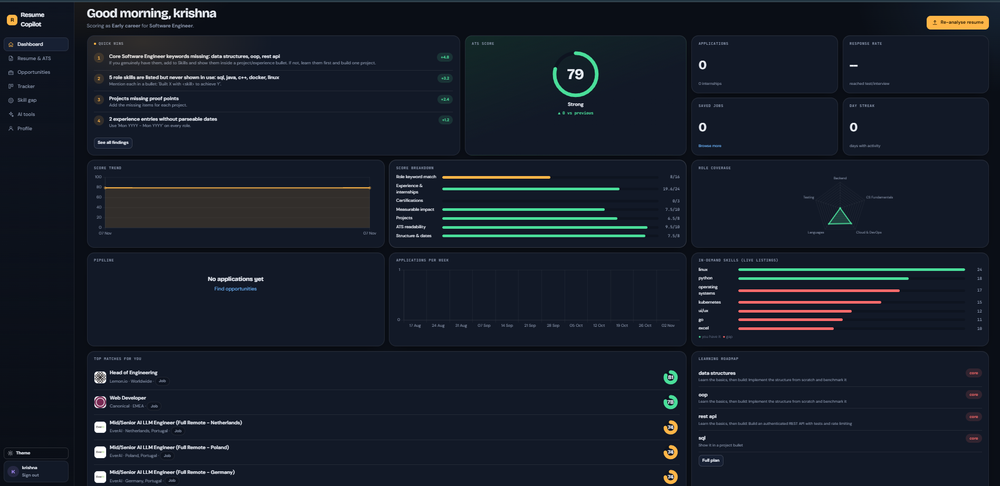
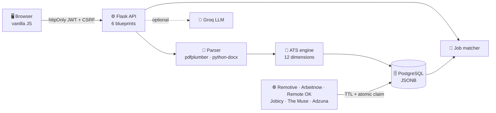
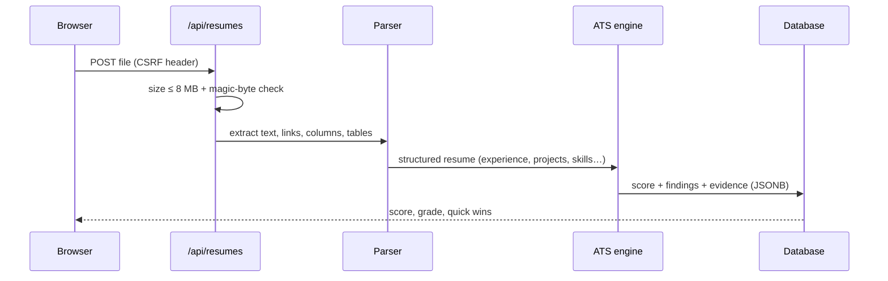
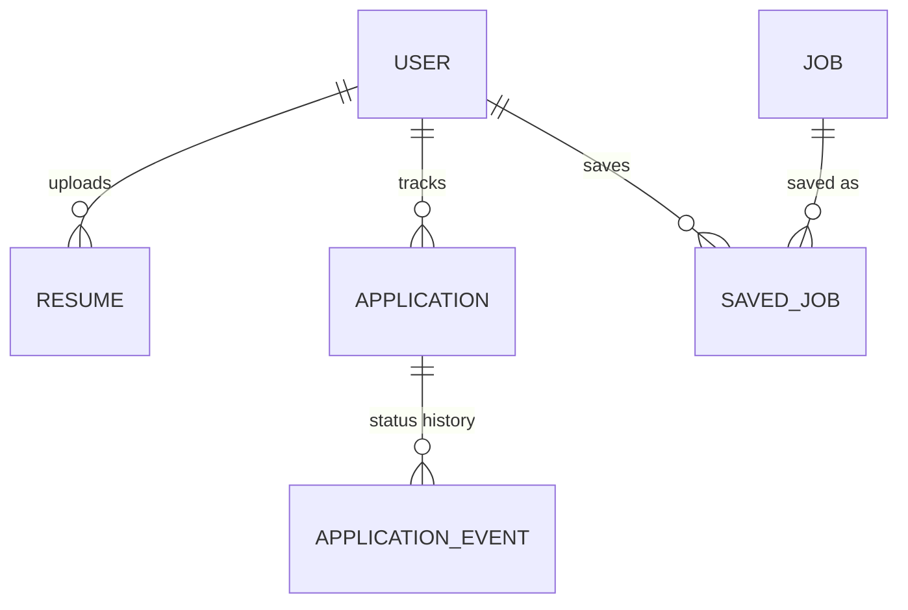

<div align="center">

# Resume Copilot

### Know exactly why your resume scores what it scores, then land the job.

A career platform with a **transparent, deterministic 100-point ATS engine**, live job matching, an application tracker and optional AI coaching.

[](https://resume-copilot-64eq.onrender.com/)
&nbsp;


**[ Try it live](https://resume-copilot-64eq.onrender.com/)** · [Features](#-features) · [How scoring works](#-how-the-ats-score-works) · [Architecture](#-architecture) · [API](#-api-reference) · [Run locally](#-run-locally)

<br>



</div>

> 💡 **Core idea:** same resume + same role → **same score, every time.** The LLM explains and rewrites, but it **never** touches the number.
>
> ⏳ The free Render instance sleeps when idle, so the first load can take ~30-50 s.

---

## 📊 At a glance

| | | | |
|:--:|:--:|:--:|:--:|
| **12** ATS dimensions | **3** career stages | **14** role profiles | **178** skills / 248 aliases |
| **37** endpoints | **6** job feeds | **34** tests | **8 MB** upload limit |

---

## Features

<table>
<tr>
<td width="50%" valign="top">

### Explainable ATS score
Every point has evidence: what was found, what is missing, and the exact fix with its **point gain** ("+8.1 pts").
Hard caps: unreadable text → 35, no email → 60, no headings → 50.

</td>
<td width="50%" valign="top">

### JD matching
Paste a job description and get required vs preferred skills, labelled **in use / listed only / missing**.
`score = 0.7·skills + 0.2·keywords + 0.1·experience fit`

</td>
</tr>
<tr>
<td valign="top">

### Live opportunities
Jobs, internships and freelance gigs from free feeds, ranked by match to **your** resume.
`match = 0.55·skills + 0.25·role + 0.15·level + 0.05·recency`

</td>
<td valign="top">

### Application tracker
Kanban pipeline with status history: `saved → applied → OA → interview → offer / rejected`.

</td>
</tr>
<tr>
<td valign="top">

### Analytics dashboard
ATS trend, funnel, response rate, average days to first response, 12-week chart, 26-week activity heatmap, streak, market demand vs your skills, and a skill roadmap.

</td>
<td valign="top">

### AI coach (optional)
Recruiter-style review, JD tailoring, outreach messages (4 kinds) and interview feedback. **Works without an API key** using templates and STAR-based heuristics.

</td>
</tr>
</table>

<details>
<summary><b>🧪 More tools (click to expand)</b></summary>

- **Role-based skill gap:** core / important / nice-to-have skills per role, with a weeks-to-learn roadmap.
- **Interview practice:** question bank plus answer evaluation (STAR structure, metrics).
- **Outreach generator:** 4 message types, AI-written or template-based.
- **Explore:** deep links to job boards, pre-filled for your role.
- **Research feed:** latest papers from arXiv and OpenAlex for research-track roles.
- **Version history:** every upload is scored; the last 20 are kept so you can see your trend.
- **Download / re-score:** re-score any saved resume against a different target role.

</details>

---

## How the ATS score works

The score is a weighted sum of **12 dimensions**. Weights depend on your **career stage**, so a fresher is not judged like a 10-year engineer. Each stage sums to exactly 100 (asserted in tests).

| Dimension | 🎓 Fresher | 🌱 Early | 💼 Experienced |
|---|:--:|:--:|:--:|
| Experience & internships | 14 | 24 | 30 |
| Role keyword match (skills) | 16 | 16 | 16 |
| Projects | 14 | 8 | 4 |
| Measurable impact | 8 | 10 | 12 |
| ATS readability (parse) | 10 | 10 | 10 |
| Structure & dates | 8 | 8 | 8 |
| Bullet writing | 8 | 8 | 8 |
| Contact & links | 6 | 6 | 6 |
| Education | 6 | 4 | 2 |
| Certifications | 4 | 3 | 2 |
| Open source | 4 | 2 | 1 |
| Achievements | 2 | 1 | 1 |
| **Total** | **100** | **100** | **100** |

<details>
<summary><b>🔬 What counts as a "real metric"?</b></summary>

9 regex patterns detect numbers that show impact: percentages, multipliers (`3x`), money (`Rs 40000`), counts (`12,000 daily requests`) and before/after values (`F1 0.71 → 0.84`).
They **ignore** years, phone numbers, CGPA and version numbers (`python 3.11`), so noise cannot game the score.

</details>

<details>
<summary><b>🛡️ How AI is kept honest</b></summary>

- The score is computed **only** by deterministic code; AI cannot change it.
- Bullet rewrites are **verified against your resume text**, so the model cannot invent facts.
- A prompt-injection guard is applied to uploaded text and job descriptions.
- Model fallback chain (default `openai/gpt-oss-120b` → `llama-3.3-70b-versatile` → `openai/gpt-oss-20b`) with retries.

</details>

---

## Architecture



<details>
<summary><b> Resume upload flow</b></summary>



</details>

<details>
<summary><b> Data model</b></summary>



7 tables (plus `source_sync` for feed status) · unique `lower(email)` index · unique `(source, external_id)` on jobs · JSONB for parsed resume, analysis and AI review.

</details>

---

## 🌐 Job sources

| Source | Cache TTL |
|---|:--:|
| Arbeitnow | 4 h |
| Jobicy | 6 h |
| Remote OK | 6 h |
| Remotive | 8 h |
| The Muse | 8 h |
| Adzuna (needs key) | 30 min per query |

Jobs are cached in the DB. A refresh slot is taken with an **atomic `UPDATE`**, so concurrent workers never double-fetch. One failing source never breaks the others, and jobs older than 45 days are pruned.

---

## 🔐 Security

| Layer | What is done |
|---|---|
| Auth | Password hashing (werkzeug), JWT in **httpOnly** cookies, access 2 h / refresh 30 d |
| CSRF | Double-submit token required on every write (tested) |
| Uploads | PDF/DOCX/TXT only, **magic-byte** check, 8 MB cap |
| Isolation | Resumes are user-scoped; another user's resume returns 404 (tested) |
| Browser | CSP + security headers; dynamic HTML escaped on the frontend |
| Abuse | Per-route rate limits (Flask-Limiter) |
| Config | App refuses to start in production with a `SECRET_KEY` under 32 chars |

---

## API reference

<details>
<summary><b>All endpoints (click to expand)</b></summary>

| Area | Endpoints |
|---|---|
| **Auth** | `POST /api/auth/register` · `login` · `logout` · `refresh` · `change-password` · `GET /api/auth/me` · `PUT /api/profile` · `DELETE /api/auth/account` |
| **Resumes** | `POST /api/resumes` · `GET /api/resumes` · `GET /resumes/latest` · `GET/DELETE /resumes/<id>` · `GET /resumes/<id>/download` · `POST /resumes/<id>/rescore` · `ai-review` · `jd-match` · `tailor` |
| **Opportunities** | `GET /api/opportunities` · `GET /opportunities/<id>` · `POST/DELETE /opportunities/<id>/save` · `GET /api/saved` · `GET /api/sources/status` · `GET /api/explore` · `GET /api/research` · `GET /research/topics` |
| **Tracker** | `GET/POST /api/applications` · `PATCH/DELETE /applications/<id>` |
| **Analytics** | `GET /api/analytics/overview` · `GET /api/skill-gap` |
| **Tools** | `GET /api/meta` · `POST /api/outreach` · `GET /api/interview/questions` · `POST /api/interview/evaluate` |
| **Ops** | `GET /healthz` |

</details>

---

## Testing

**34 tests** run in CI on **SQLite and PostgreSQL**, and the migration is checked too.

| Suite | Covers |
|---|---|
| `test_ats.py` | weights sum to 100, metric detection (ignores years/phones/CGPA), determinism, role sensitivity, JD match, stage detection |
| `test_extract.py` | PDF/DOCX/TXT parsing, links, layout checks |
| `test_api.py` | register/login/logout, cookie flags, CSRF, upload + magic bytes, user isolation, tracker, analytics, job dedupe, TTL claim, failure containment |
| `test_ai.py` | AI helpers and fallbacks with no API key |

```bash
pip install -r requirements-dev.txt && pytest -q
```

---

## Project structure

```
app/
├── blueprints/     # route groups: auth, resumes, opportunities, applications, analytics, tools
├── services/       # ats.py · resume_parser.py · skills.py · matching.py · ai.py · analytics.py
├── sources/        # job feed providers, registry (TTL + atomic claim), research, explore
├── static/js/      # frontend modules (dashboard, resume, tracker, tools…)
└── templates/
migrations/         # Alembic versioned schema, so `flask db upgrade` builds all tables anywhere
tests/              # pytest suite + fixtures/ (fresher, experienced, weak sample resumes)
.github/workflows/  # CI: pytest on SQLite + PostgreSQL, migration check
Dockerfile · docker-compose.yml · render.yaml · start.sh
```

---

## Run locally

```bash
git clone https://github.com/Krish033-source/resume-copilot && cd resume-copilot
python -m venv .venv && source .venv/bin/activate
pip install -r requirements.txt
cp .env.example .env          # set SECRET_KEY (32+ chars); GROQ_API_KEY is optional
flask db upgrade && flask run
```

**Docker:** `docker compose up`

<details>
<summary><b>⚙️ Environment variables</b></summary>

| Variable | Purpose | Default |
|---|---|---|
| `SECRET_KEY` | Flask/JWT secret (32+ chars in production) | required |
| `DATABASE_URL` | PostgreSQL URL | none |
| `GROQ_API_KEY` | Enables AI features | off |
| `GROQ_MODEL` | Primary model | `openai/gpt-oss-120b` |
| `ADZUNA_APP_ID` / `ADZUNA_APP_KEY` | Extra job source | off |
| `COOKIE_SECURE` | Secure cookies (set `0` for local http) | `1` |
| `AUTO_REFRESH_SOURCES` | Refresh job feeds in background | `1` |
| `RATELIMIT_STORAGE_URI` | Limiter backend (Redis for multi-worker) | `memory://` |
| `CORS_ORIGINS` | Allowed origins | empty |

</details>

---

## ⚠️ Limitations

- The ATS score is an **explainable heuristic**, not any employer's real ATS.
- The in-memory rate limiter needs a **single worker**; use Redis (`RATELIMIT_STORAGE_URI`) to scale out.
- `/api/opportunities` scores up to 500 cached jobs per request. Fine at this scale, but would need pre-computed scores beyond it.

## 🗺️ Roadmap

- [ ] Redis-backed rate limiting
- [ ] Pre-computed job match scores
- [ ] Test coverage report in CI
- [ ] Resume diff view between versions

---

<div align="center">

Built by **[Krishna Lal](https://krbtech.xyz)** · [GitHub](https://github.com/Krish033-source)

⭐ Star the repo if it helped your resume.

</div>
